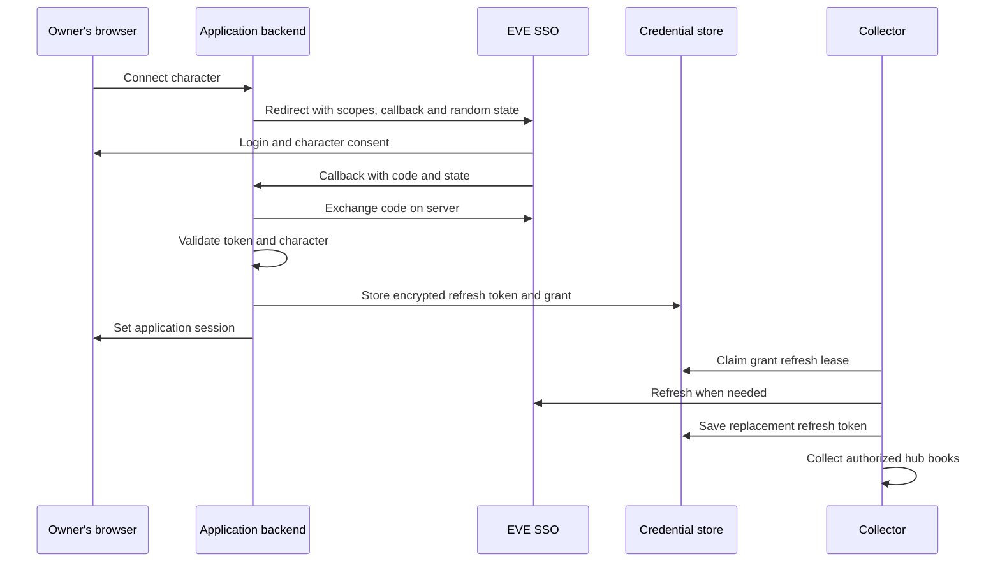

# EVE API and character authorization

Research date: **2026-11-06**. [Discovery index](README.md).

**Scope update:** the owner has confirmed that one character can access both private hubs and that the resulting market snapshots may be public. The [GitHub-only evaluation](04-github-only-vs-cloudflare.md) therefore proposes local OAuth setup and an unattended collector, without visitor login or a permanent callback server. The ESI endpoints/scopes, token lifecycle and data limitations below still apply; the permanent web-session design is an optional broader architecture.

## Recommended access model

Use EVE's REST API, **ESI**, with EVE SSO for character-authorized routes. Register an application once; each collector character then authorizes that application. The resulting access and refresh tokens replace the idea of a manually issued character API key. Public endpoints can be used without character authentication. [ESI overview](https://developers.eveonline.com/docs/services/esi/overview/).

The confirmed requirements are two player-owned hubs: Siseide's **Tortuga** and the existing **C-J6MT** location. Both require character access. Jita can use public regional market orders filtered to the chosen station.

Start with one owner-managed collector character if it can access both structures. If access differs, connect separate characters and associate each grant with the hubs it actually reaches. Site visitors need not each collect the same book: a small, explicitly allowed audience can view the owner's collected snapshots. If the product instead needs each visitor's private view, introduce per-character collection profiles and isolate their data. This choice should be made before a public launch.

## What to request from ESI

Paths below are relative to `https://esi.evetech.net`. These paths, scopes, parameters, and field availability were checked against the downloaded [official OpenAPI specification](https://esi.evetech.net/meta/openapi.json), requested with compatibility date `2026-11-05` (returned schema `2026-08-18`). Use the [API Explorer](https://developers.eveonline.com/api-explorer) to inspect them interactively.

| Purpose | Endpoint | Authentication / use |
| --- | --- | --- |
| Tortuga or C-J6MT orders | `GET /markets/structures/{structure_id}` | Character token with `esi-markets.structure_markets.v1`; retrieve every page. |
| Confirm structure identity and system | `GET /universe/structures/{structure_id}` | `esi-universe.read_structures.v1`; validate access and expected system. |
| Jita book | `GET /markets/{region_id}/orders?order_type=all&page=1` | Public; filter returned `location_id` to the selected station. Optional `type_id` narrows a request. |
| Regional daily trading history | `GET /markets/{region_id}/history?type_id=...` | Public; one region/type pair, with daily price statistics and traded volume. |
| Item identity and hauling volume | `GET /universe/types/{type_id}` | Public; cache names, market groups, and volume metadata. |
| Static universe/type catalog | Static Data Export (SDE) | Import a versioned subset; avoid thousands of repeated type lookups. |
| Resolve known system names | `POST /universe/ids` | Public lookup; useful for Siseide and C-J6MT, not a private-structure directory. |

Regional order books omit structure-local orders except certain ranged orders. Fetch each structure's own book and deduplicate by `order_id` if combining sources. Its endpoint returns both sides of the book; it has no type/side filter. Access depends on the character's structure permissions, not just having the scope. [Official structure-market guide, archived](https://docs.esi.evetech.net/docs/scenarios/structure_markets.html).

The public structure list is incomplete for restricted-access structures. Prefer a configured numeric ID, then validate it with the authorized structure-details endpoint. Tortuga's intended name is insufficient: names can change or collide. Obtain its ID from an in-game location link or an authorized lookup. Treat `1049588174021`, found in this repo's C-J6MT scraper URLs, as a candidate to verify. [Official structure-ID guide, archived](https://docs.esi.evetech.net/docs/scenarios/resolve_structure_ids.html).

Jita's conventional reference is The Forge region `10000002`, station `60003760`. Validate the configured station through the public station endpoint during setup. Use numeric IDs as identity, and retain readable names as metadata. A region, solar system, NPC station, and player structure are different objects: selecting Siseide alone does not specify Tortuga.

### A first read-only request

For example, PowerShell can fetch one page of public The Forge orders without a character token:

```powershell
$esiRequestHeaders = @{
    "X-Compatibility-Date" = "2026-11-05"
}
$esiPage = Invoke-WebRequest -UseBasicParsing -UserAgent "GoonmetricsDiscovery/0.1 (replace-with-your-contact)" -Headers $esiRequestHeaders -Uri "https://esi.evetech.net/markets/10000002/orders?order_type=all&page=1"
$esiPage.Headers["X-Pages"]
$jitaStationOrders = ($esiPage.Content | ConvertFrom-Json) | Where-Object { $_.location_id -eq 60003760 }
```

This demonstrates transport and filtering, **not a complete book**. Fetch the remaining pages named by `X-Pages`, observing cache/rate headers, before publishing results. For a structure request, use its endpoint from the table and an `Authorization: Bearer <access-token>` header obtained through the server-side flow below. A character token belongs in protected process memory/configuration, not committed example text. Replace the example User-Agent contact before live testing.

## Obtaining access: proposed setup

1. Sign in to the [EVE developer application portal](https://developers.eveonline.com/applications). Create an application for authentication/API access, supply its details, and register callback URLs. Use separate development and production applications to keep local experiments independent.
2. Request **`esi-markets.structure_markets.v1`** and **`esi-universe.read_structures.v1`**. These cover collection and identity validation. Character/corporation wallet, assets, mail, director roles, and personal-order scopes are unnecessary for this initial task.
3. Save the application's client ID and, for a confidential web client, its secret in server-side configuration. Have the owner use **Connect EVE character** and choose a character that can access Tortuga and/or C-J6MT.

Application creation and client credentials are described in the [official registration guide, archived](https://docs.esi.evetech.net/docs/sso/creating_sso_application.html). Follow the current portal if field labels differ from that older guide.

### OAuth flow

Use the documented authorization-code flow for a confidential backend. EVE also documents authorization code with **PKCE/S256** for public clients; if using PKCE with a confidential client, prove that combination during the authentication spike. Do not assume a browser-only design is appropriate for scheduled collection. [Current EVE SSO guide](https://developers.eveonline.com/docs/services/sso/).



Discover SSO metadata at `https://login.eveonline.com/.well-known/oauth-authorization-server`. Authorization uses `https://login.eveonline.com/v2/oauth/authorize`; token exchange uses `https://login.eveonline.com/v2/oauth/token`. Validate the JWT signature with discovered keys, issuer, expiry, expected audiences (including this client), character subject, and granted scopes. Bind a cryptographically random, one-use `state` to the initiating browser session. [EVE SSO validation and endpoints](https://developers.eveonline.com/docs/services/sso/).

Proposed implementation details:

- Keep OAuth code exchange and the callback on the backend. Use a real path such as `/auth/eve/callback`, then redirect to `/#/imports`. A hash-router path cannot serve as the backend callback.
- Register the exact local callback, for example `http://localhost:8787/auth/eve/callback`, if accepted by the portal. If local HTTP is rejected, use local HTTPS or an HTTPS tunnel with the same callback path. Production uses a registered HTTPS URL.
- Establish an opaque application session with `HttpOnly`, `Secure` in production, and appropriate `SameSite` cookies. Prefer serving UI and API from one origin. Use CSRF protection for connect/disconnect and refresh requests.
- Encrypt refresh tokens with authenticated encryption and a versioned server-managed key. Store owner/character identity, scopes, expiry, connection status, and hub grants alongside them. Do not put tokens or the client secret in `VITE_*`, browser storage, URLs, Actions artifacts, or logs.
- A valid EVE login establishes character identity; it does not automatically admit someone to the app or grant access to every cached hub. Apply the selected viewer policy on each data request.
- On disconnect/revocation, stop collection for that grant and remove its credentials. Update access state and retention according to the viewer policy. Separate a real zero-order market from permission loss.

### Refreshing without another login

Use `expires_in` to schedule access-token refresh; the documented example is 1,200 seconds. A backend refresh sends a form-encoded `grant_type=refresh_token` request to the token endpoint, with confidential-client authentication. Persist any returned replacement refresh token before another job uses that grant. On `invalid_grant`, require reconnection instead of retrying indefinitely. [Official refresh guide, archived](https://docs.esi.evetech.net/docs/sso/refreshing_access_tokens.html).

Use one durable lease per grant so callback validation, scheduled collection, and manual refresh cannot race token rotation. Do not rely on a static GitHub secret containing the initial refresh token: the current value must live in the credential store. GitHub secrets can hold the collector's service credential and encryption key instead.

## Collection behavior

Use the same collection service for timer and manual requests:

1. Claim a durable job/lease for the hub and collection profile. Coalesce duplicate requests and check `nextEligibleAt`.
2. Refresh credentials if necessary. For public Jita requests, omit the character token unless there is a deliberate reason to send it.
3. Fetch page 1 and follow `X-Pages`, with bounded concurrency. Keep ETags and cached bodies **per page**, endpoint, parameters, compatibility date, and relevant authorization profile. A `304` means reuse that page's cached body.
4. Stage pages and record their collection times. Reconcile duplicates and changing page counts; retry a bounded number of times if the book shifts materially. Multiple ESI requests are not an atomic market snapshot.
5. Normalize by `type_id`, side, and location; validate required fields. Derive quotes under a versioned strategy. Publish a complete generation only after all required pages succeed.
6. Save completion, next eligible time, page counts, and errors. Retain the last successful generation on failure; return it with a visible stale/degraded status if the viewer still has access.

These are proposed service semantics. They deliberately replace the current “refresh during a GET after a process-local TTL” approach.

ESI supports compatibility dates; pin a reviewed date in configuration and fixtures, and update it deliberately. Do not set it to a moving “today” value. The successful discovery request used `2026-11-05`, resolving to schema version `2026-08-18`; neither date is proof of tested runtime integration. [ESI versioning](https://developers.eveonline.com/docs/services/esi/overview/).

Respect upstream cache headers and use a descriptive application/contact User-Agent. Start with a **30–60 minute collector schedule**, and refresh daily history after its daily update. Buttons cannot bypass ESI's cache. [ESI best practices](https://developers.eveonline.com/docs/services/esi/best-practices/). Market-order polling has an explicitly documented five-minute cache; there is no benefit in repeatedly fetching it inside that window. [February 2026 market-order update](https://developers.eveonline.com/blog/market-orders-rate-limit-rolls-out-on-february-24-2026).

Handle both `X-Ratelimit-*` group budgets and legacy `X-Esi-Error-Limit-*` where present. On `429` respect `Retry-After`; pause on legacy `420`. Use bounded exponential backoff with jitter for transient failures. Refresh once on an expired-token `401`; stop and report structure-access failure for `403`, with later bounded revalidation. The reviewed regional-orders schema advertises a `market-order` budget of 12,000 tokens per 15 minutes; do not generalize this to every endpoint or count it as 12,000 requests. [Current rate-limit rules](https://developers.eveonline.com/docs/services/esi/rate-limiting/).

## Replacing the scraped fields

This is the most consequential product difference. ESI is a source of raw books and regional aggregates; it does not reproduce Goonmetrics' derived table.

| Current field / behavior | Proposed source and meaning |
| --- | --- |
| Generated `id`, `itemName` | Canonical `type_id` plus a cached display name. Retain legacy IDs only inside the adapter. |
| `jitaPrice`, `cjPrice` | A quote selected from a named location, book side, timestamp, and strategy. Add Tortuga through configuration, not another hardcoded column. |
| `itemVolumeM3` | Prefer packaged volume for packaged cargo, with documented item-specific rules and explicit fallback to ordinary volume where appropriate. Cache ESI/SDE metadata. |
| `markupPercent`, `weekMarkupISK` | Calculate under the app's own versioned policy. Keep upstream legacy figures only with their original provenance. |
| `weekVolume` | Nullable metric with source, geographical scope, date window, and confidence. No direct structure-sales equivalent exists in the reviewed market-history route. |
| `top500`, `marketgroup` | Keep as legacy providers; later offer “top opportunities” and “all tracked types” over the same ESI dataset. Do not inherit Goonmetrics' unknown ranking semantics. |

The current API infers hauling volume from `(upstream import price - Jita price) / 1000`; the frontend then charges **700 ISK/m³**. Replace that inference with type metadata. The static catalog can also supply groups and names without repeated live requests. [Official static-data downloads](https://developers.eveonline.com/static-data), [using static data](https://developers.eveonline.com/docs/guides/staticdata/).

### Weekly volume and profit

The reviewed history endpoint is keyed only by **region and item type**. It returns daily `volume`, prices, and `order_count`, with no system/structure filter. It does not reveal complete Tortuga/C-J6MT sales, trade direction, or other players' transactions. Character wallet transactions would describe that character's activity, not the entire hub. See the market-history and wallet schemas in the [official specification](https://esi.evetech.net/meta/openapi.json).

Proposed choices, in order:

1. Ship accurate price comparisons and stock/depth first; show hub weekly sales and estimated weekly profit as unavailable.
2. Offer the sum of the last seven **completed UTC days** of regional history as a distinctly labeled regional reference. Missing dates/insufficient history must be explicit. Do not label it Tortuga demand or silently use it in weekly-profit ranking.
3. If useful, develop an **estimated order-book depletion** metric from our snapshots. A disappearing order might have sold, expired, or been canceled; edits and collection gaps introduce further ambiguity. It cannot be reported as exact sales. Validate the estimate against volunteered real transactions and keep method/confidence metadata.
4. Retain legacy Goonmetrics volume for its existing C-J6MT view, labeled by source. Do not transplant it to Tortuga. Document that Goonmetrics' demand methodology remains unverified.

The calculation layer must accept missing volume: keep unit profit available, and leave `weeklySizeMoved`, weekly profit, and volume-based filler score unavailable until the user selects a defined demand model. This is a deliberate behavior change requiring UI and regression tests.

### Price and transport policy

Configure these explicitly before comparing results:

- Acquisition: immediate purchase from sell orders, or a proposed buy-order strategy.
- Destination sale: immediate sale into buy orders, or listing against sell orders.
- Quote size: best price for a tiny amount versus depth-weighted cost/proceeds for a selected quantity. Honor minimum volume and available depth; never imply that all inventory can trade at the best displayed price.
- Buy-order range: orders placed at a location differ from orders elsewhere that can accept goods there. Begin with exact-location matching; add range-aware execution only with validated reachability rules.
- Hub-specific haul fees, packaged volume, taxes, broker/relist assumptions, and a visible strategy/version. The existing 5.37% base expense and 0.3% per relist are current code defaults, not verified universal game rules.

The existing buy/sell toggle switches the **Jita source view**; it does not independently specify both legs of a trade. Preserve this as legacy behavior while designing clearer acquisition/sale controls.

## Alternatives to direct collection

- **Continue scraping:** preserves the old C-J6MT view while ESI is introduced, but cannot add Tortuga if Goonmetrics does not support it.
- **Use a community market service:** potentially useful for public Jita pricing; verify coverage, freshness, terms, and availability before depending on it. No reviewed service has been established here as a replacement for character-visible Tortuga/C-J6MT books.
- **Owner-operated collector:** a local Node process can refresh and upload snapshots using the same service code. It avoids hosted collector compute but depends on a running machine. Useful for development or fallback, not an unattended service unless that dependency is acceptable.
- **All collection in the browser:** convenient for manual prototypes, but does not satisfy durable scheduled collection when the browser is closed. Prefer backend-managed grants.
