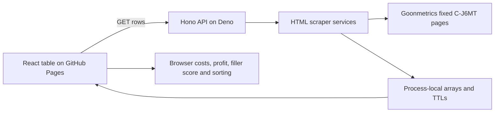
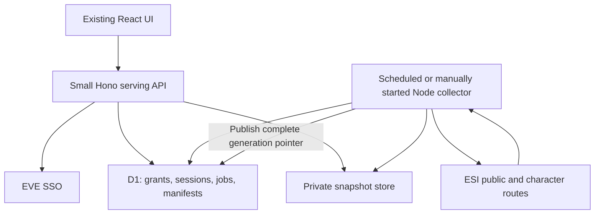

# Architecture and hosting assessment

Research date: **2026-11-06**. [Discovery index](README.md).

**Scope update:** the subsequent [GitHub-only evaluation](04-github-only-vs-cloudflare.md) incorporates public snapshot distribution, one owner character, 60,000 small rows, hourly-to-eight-hour updates and latest-only storage. It recommends prototyping Actions + Pages first. The backend/database assessment below records the earlier broader design and remains relevant if private viewers, individual grants or interactive jobs are required; it is no longer the minimum recommended architecture.

## Assessment

**Keep the monorepo, React/Vite UI, Hono routing model, and reusable calculation/sorting code. Replace the process-local scraper pipeline with a durable market-ingestion service and location-neutral contracts. Plan to move off Deno hosting and Deno-only tooling.**

Siseide does not inherently require a new frontend framework, microservices, Redis, Kubernetes, or a large database. It does require explicit hub identity, character credentials, independent collection, persistence, and clarity about unavailable demand data. The strongest reason to change runtime/hosting now is the vendor's newly announced retirement, not an inherent inability of Hono or TypeScript to handle ESI.

For the confirmed $0 preference, prototype a small Cloudflare serving layer plus a scheduled Node collector. Keep a conventional Node/Hono + PostgreSQL variant as the portability comparison. Select between them using measured collection/storage costs and local startup/deployment tests, rather than a general preference for an edge platform.

## Repository evidence

Inspected at commit `7ee5957d60feebd095823c3a4a16a55ccbd3d7a0`; the worktree was clean before discovery. These are source observations, not claims about the currently deployed application.

| Area | Evidence | Consequence |
| --- | --- | --- |
| API entry point | [`server.ts`](../../apps/api/src/server.ts) creates Hono, two service/repository pairs, broad CORS, `/health`, and `Deno.serve`. | A small composition root is reusable. Extract app creation from Deno startup for alternate hosts and route tests. |
| Data acquisition | [`BaseScraperService.ts`](../../apps/api/src/services/BaseScraperService.ts), [`Top500ScraperService.ts`](../../apps/api/src/services/Top500ScraperService.ts), [`MarketGroupScraperService.ts`](../../apps/api/src/services/MarketGroupScraperService.ts). | HTML parser depends on first-table/cell positions; both sources hardcode location `1049588174021`. Refresh happens during reads, after 5-minute or 1-hour TTL. |
| Cache/repository | [`InMemoryItemRepository.ts`](../../apps/api/src/repositories/InMemoryItemRepository.ts). | Everything disappears on restart and differs by instance. No shared leases, durable snapshots, or transactional replacement. |
| Failure handling | Market-group collection catches subpage errors and continues. Base parsing can return an empty table result; numeric parsing defaults to zero. | A partial/empty dataset can become a fresh cache entry. New ingestion must preserve completeness and distinguish missing values. |
| Concurrent refresh | Base service has independent buy/sell timestamps but clears/rebuilds a shared array without locking. | Concurrent refreshes can duplicate requests or overwrite another refresh's data. A durable generation and lease model is needed. |
| API surface | [`scrape-json.ts`](../../apps/api/src/routes/scrape-json.ts), [`scrape-marketgroup.ts`](../../apps/api/src/routes/scrape-marketgroup.ts), [`scrape.ts`](../../apps/api/src/routes/scrape.ts), [`items.ts`](../../apps/api/src/routes/items.ts), [`ingest.ts`](../../apps/api/src/routes/ingest.ts). | First two are real table APIs. `/api/scrape` fetches a W3Schools demo; `/items` and `/ingest` are placeholders. Do not build a migration around those stubs. |
| Shared data | [`importRow.ts`](../../packages/shared/src/importRow.ts) currently exports `ScrapedRow` and `OrderType`. | `jitaPrice`, `cjPrice`, mandatory `weekVolume`, and sequential row IDs embed legacy assumptions. There is no canonical EVE type ID or freshness/provenance envelope. |
| Calculation rules | [`tradeCalculations.ts`](../../apps/web/src/lib/tradeCalculations.ts). | Pure helpers are useful. Defaults are 5.37% sale expense, 0.3% per relist, 700 ISK/m³, and filler weights 80/10/10. Exports exclude `cjPrice <= 0`. These are app assumptions to preserve/version, not facts about every hub. |
| UI performance | [`TradeTable.tsx`](../../apps/web/src/components/TradeTable.tsx), [`tradeSorting.ts`](../../apps/web/src/lib/tradeSorting.ts), [`tradeVirtualization.ts`](../../apps/web/src/lib/tradeVirtualization.ts). | Derived rows and sorting are memoized separately; rows are virtualized. Preserve these gains. Server pagination can come later if measurement warrants it. |
| Fetching | [`useScrapedRows.ts`](../../apps/web/src/hooks/useScrapedRows.ts). | Fetches on source/order-type changes. No scheduled polling or refresh button. React Query is provided at startup but this hook uses local state/effects. |
| Navigation | [`main.tsx`](../../apps/web/src/main.tsx), [`tradeModes.ts`](../../apps/web/src/lib/tradeModes.ts). | Hash routing works on static hosting; labels and route assumptions name Jita/C-J6MT directly. Browse Data remains a placeholder. |
| Database | [`prisma/README.md`](../../apps/api/prisma/README.md), [`schema.prisma`](../../apps/api/prisma/schema.prisma). | Commented PostgreSQL example only; no live schema, migrations, or Prisma integration to preserve. |
| Deployment | [`deploy-pages.yml`](../../.github/workflows/deploy-pages.yml). | Only tracked workflow builds the web app and deploys GitHub Pages. It hardcodes a `.deno.net` API origin. There is no tracked API deployment or coordinated release. |
| Configuration | [`vite.config.ts`](../../apps/web/vite.config.ts), [`.env.example`](../../apps/web/.env.example), [`.gitignore`](../../.gitignore). | Production asset base is `/react-parse-goonmetrics/`. Example says `VITE_API_BASE`, but the hook expects `VITE_API_BASE_URL`. Only root `/.env` is ignored; nested secrets and future `.dev.vars` need explicit ignore rules. |
| Tooling | [`apps/api/deno.json`](../../apps/api/deno.json), [`apps/api/tsconfig.json`](../../apps/api/tsconfig.json), [`apps/web/package.json`](../../apps/web/package.json), root lockfiles. | API imports mix `@sharedTypes/` and `@gm/shared`; only the former is in the Deno import map. Validate alias resolution. Deno check task uses `--unstable src`, which needs verification with the selected Deno version. Web build runs Vite without `tsc`. Both npm and pnpm locks are tracked. |
| Validation | Four web library test files contain 14 `Deno.test` cases, plus sort/render benchmarks. | Existing arithmetic/sort/virtualization coverage is reusable. No tracked API/auth/database integration suite or CI test step was found. |



The workflow establishes GitHub Pages as the frontend vendor and Deno as the configured API destination. It does **not** reveal the API account's deployment mechanism, region, current plan, secrets, or current availability. A `.deno.net` address alone does not identify Classic versus newer Deploy conclusively.

## Hosting options

Prices below are USD public list prices researched on the stated date. They are not an account-specific quote, and free allowances can be shared with other projects. Public provider subdomains avoid a required custom-domain purchase.

| Option | Current cost facts | Fit for this project |
| --- | --- | --- |
| Existing Deno Deploy | Advertised Free $0 and Pro $20/month, but retirement now announced. [Pricing](https://deno.com/deploy/pricing), [retirement announcement](https://deno.com/blog/cloudflare). | Do not make it the new target. Newer Deploy supports PostgreSQL/KV and cron, but adding a fresh integration there creates another near-term migration. [Databases](https://docs.deno.com/deploy/reference/databases/), [cron/product changes](https://docs.deno.com/deploy/changelog/). |
| **Cloudflare Workers + D1 + private R2, scheduled collector elsewhere** | Workers Free includes 100,000 dynamic requests/day; Paid starts at $5/month. [Workers pricing](https://developers.cloudflare.com/workers/platform/pricing/). D1 and R2 have free allowances; details below. | Preferred $0-first experiment: retain Hono and React, serve a provider URL, keep bulk processing on a Node runner. More services/configuration than one container. |
| Node/Hono on Railway + PostgreSQL | Free offers limited monthly credit after its trial; Hobby has a $5 minimum with $5 included usage, then usage charges. [Railway pricing](https://railway.com/pricing). | Strong conventional alternative: app, cron and database in one project, container-friendly local operation. An app plus persistent DB is not proven to fit the free credit or cost only $5 total. [Cron](https://docs.railway.com/cron-jobs), [PostgreSQL](https://docs.railway.com/databases/postgresql). |
| Node/Hono on Render + PostgreSQL | Free app sleeps after 15 idle minutes; free PostgreSQL expires after 30 days. [Free limitations](https://render.com/docs/free). Hosted cron costs at least $1/month per cron service. [Cron jobs](https://render.com/docs/cronjobs). | Good deployment UX and container parity; the entirely free app/database combination is unsuitable for durable unattended use. Use paid infrastructure or an external durable DB. |
| **Neon backend Functions + PostgreSQL + object storage** | New backend suite announced GA September 17, 2026. [Announcement](https://neon.com/blog/neon-backend-is-ga). Free database currently includes 1 GB storage and 100 CU-hours/month/project; Functions also have an allowance. [Current pricing](https://neon.com/pricing). | Material new candidate since the original project: could combine Node handlers, SQL and snapshots in one service family. Must prove local emulation, scheduling, callback behavior, and single-command deploy before choosing it over Cloudflare. Do not assume all new primitives have mature local parity. |
| GitHub Pages plus a local collector | Existing static hosting can remain; compute depends on an owner-operated machine. | Useful bridge and recovery option. Public Pages is inappropriate for publishing character-restricted books unless that audience is explicitly intended. Keep private payloads behind an API. |

Deno's October announcement supersedes the impression given by older feature/pricing pages. It states six more months of Deploy service and one year of Deno-team runtime maintenance; approximately April/October 2027 are inferred planning windows. Separately, Classic's documentation announced retirement on July 20, 2026, already before this discovery date. Inspect the actual account before planning any emergency bridge. [Deno's current announcement](https://deno.com/blog/cloudflare), [Classic migration guide](https://docs.deno.com/deploy/migration_guide/).

Supabase, Vercel, and a self-managed VM could also host parts of the system. They do not currently remove enough uncertainty to justify additional implementation variants: the immediate shortlist covers a free edge/snapshot design, a familiar container/SQL design, and a newly integrated backend. This is a scope choice, not a claim that other vendors cannot work.

### Why a free Worker should not ingest entire books

The Workers Free budget is **10 ms CPU per invocation**, including free cron invocations, plus 128 MB memory and 50 subrequests. Network waiting is excluded from CPU, but JSON parsing, aggregation, cryptography and response serialization still consume it. A multi-page Jita book, type enrichment and historical lookups are a poor workload to assume will fit. [Current Worker limits](https://developers.cloudflare.com/workers/platform/limits/).

Keep the Worker responsible for small authenticated requests, sessions/OAuth, refresh requests, and streaming already-prepared snapshots. The Node collector fetches, validates, joins and compresses data. Cold and warm authentication paths still need a free-tier feasibility test; moving bulk work out does not prove the OAuth callback fits 10 ms.

### Storage and collection budget

D1 Free allows 5 million rows read/day and 100,000 rows written/day, with 5 GB total account storage. Writes include updates and deletes, and indexes can add write operations. Its **per-database** Free size limit is 500 MB, distinct from the 5 GB account total. [D1 pricing](https://developers.cloudflare.com/d1/platform/pricing/), [D1 limits](https://developers.cloudflare.com/d1/platform/limits/).

An illustrative 18,000-row derived table rewritten every five minutes is:

```text
18,000 × 288 refreshes/day = 5,184,000 row writes/day for one table
18,000 × 48 refreshes/day =   864,000 row writes/day at 30-minute intervals
```

Those are estimates using the repo's benchmark dataset, not measured production counts; both exceed D1 Free before indexes, cleanup or a second hub. Raw order books can be considerably larger than derived item tables. Therefore **do not store every order/item as a rewritten D1 row every refresh** in the zero-cost design.

Proposed division:

- D1: a small number of hubs, encrypted grants, sessions, collection jobs/leases, and completed-generation pointers.
- Private R2 Standard bucket: complete versioned book/quote payloads and a compact static-data subset. Store only selected types and necessary fields. Keep a rolling last-good generation and a small recovery/history window.
- Node collector: aggregation, metric derivation, optional compression, schema validation and publication. Public Jita results are shared; structure results are keyed by explicit collection/access profile.

R2 Standard includes 10 GB-month storage, 1 million Class A and 10 million Class B operations/month, with free egress; usage beyond that is billable. An R2 subscription requires a checkout/setup step even when usage is inside its free allowance. [R2 pricing](https://developers.cloudflare.com/r2/pricing/), [R2 setup](https://developers.cloudflare.com/r2/get-started/).

For example, three **5 MB stored** snapshots at 48 refreshes/day, retained for seven days, use roughly 5.04 GB, before raw pages/history/other profiles. The same pattern retained for 30 days is 21.6 GB. These are planning examples, not measured compression ratios. Enforce retention, object/byte budgets, and run quotas in the application; billing notifications alone do not guarantee a $0 bill.

If a hard no-billing boundary or avoiding an R2 subscription is essential, test **bounded chunked snapshot blobs in D1 Free** instead. A generation uses a small number of JSON/blob chunks below D1's value limits, rather than a row per item. Stream chunks without parsing them in the Worker; clients assemble a generation. Keep only a few generations within the 500 MB database ceiling. This trades query flexibility for fewer writes and requires size/latency testing. Select one snapshot adapter after the spike, not both in the first release.

### Scheduled collection at $0

GitHub Actions can run the same Node collector used locally, for example at minute 17 and 47 each hour. Standard hosted runners are free for public repositories. Private repositories have plan allowances; GitHub Free currently includes 2,000 minutes/month. At 48 runs/day for 30 days, **one billed minute/run is 1,440 minutes**, while two minutes/run is 2,880 before ordinary CI. Measure startup, install and collection time rather than assuming the collector fits. [Actions billing](https://docs.github.com/en/billing/concepts/product-billing/github-actions), [included usage](https://docs.github.com/en/billing/reference/product-usage-included).

Schedules are best effort: jobs can be delayed or dropped under load, and public-repository schedules can disable after 60 days without repository activity. Report collection age and support manual recovery; do not promise an exact 30-minute SLA. [Schedule troubleshooting](https://docs.github.com/en/actions/how-tos/troubleshoot-workflows), [automatic disabling](https://docs.github.com/en/actions/how-tos/manage-workflow-runs/disable-and-enable-workflows).

Use repository-owned scheduled/manual workflows with `contents: read`, a per-environment concurrency group, a run timeout and bounded workload. Never expose service credentials to forked PRs. Credentials belong in secrets and the database; private market payloads belong in private storage, not commits or downloadable workflow artifacts. A public source repository does not require public market data.

The web button can enqueue a refresh for the next collector run. An owner can immediately trigger `workflow_dispatch` in GitHub. A future in-app immediate dispatch requires a narrowly scoped GitHub App/token kept on the backend, plus throttling; do not silently introduce that credential in the first version. GitHub Actions is a compromise for this small delayed batch workload, not the long-term choice if dependable frequent jobs become essential.

## Proposed system boundaries



Hono has documented [Workers](https://hono.dev/docs/getting-started/cloudflare-workers) and [Node](https://hono.dev/docs/getting-started/nodejs) targets. Preserve domain logic behind small interfaces (`MarketProvider`, `CredentialStore`, `SnapshotStore`, `CollectionJobStore`, clock/fetch). Supply runtime-specific entry points and storage adapters. Avoid a large generic persistence framework before these access patterns are measured.

On Cloudflare, collection can access D1 through its authenticated REST interface and R2 through S3-compatible access; runtime bindings stay in the serving adapter. A trusted collector needs the encryption key and narrowly scoped storage credentials in its environment. Use database conditional updates for durable leases, version checks for token rotation, and small atomic publication operations. An alternative is a bounded authenticated internal API, but sending large books through it would reintroduce Worker CPU/limits. [D1 remote query API](https://developers.cloudflare.com/api/resources/d1/subresources/database/methods/query/), [R2 access methods](https://developers.cloudflare.com/r2/get-started/).

### Is a formal database warranted?

**For the broader authenticated/multi-profile design, yes.** OAuth grants, access policy, connection health, job idempotency, leases and current-generation pointers are durable state, even if raw books remain replaceable cache objects. This is a small relational workload; D1 is sufficient to test it. A Prisma placeholder does not commit the project to Prisma. For the clarified single-owner/public-static design, GitHub workflow serialization, a durable credential record and published JSON can provide the required state without a formal database; see document 4.

PostgreSQL is preferable if the product grows into extensive order history, per-character analytics, SQL queries over books, multi-writer jobs, or stronger relational workflows. For that variant, store grants/jobs/metadata and selected book/history records in PostgreSQL, using transactions and exact money representations. Keep raw response archives bounded. Local Docker PostgreSQL should match production migrations; do not use SQLite as a substitute test database for a PostgreSQL release.

Neither a new ORM nor MongoDB solves the missing structure-sales history. That is an upstream-data limitation, not a storage limitation.

## Provisional decision and selection criteria

**Preferred experiment:** Workers Free + D1 operational state + private snapshots + Node scheduled collector. Retain UI and pure trade logic, and replace Deno-only runtime imports/tooling incrementally. Use same-origin static hosting to simplify OAuth cookies and remove the GitHub Pages path/cross-site-cookie coupling when ready.

**Compare with:** Node/Hono + PostgreSQL locally, deployable to Railway or another container host. Also time-box a Neon Functions experiment because its recent integrated backend could materially reduce service count.

Choose the free design only if it passes local tests, cold OAuth/serving CPU limits in staging, storage/Actions budgets, and acceptable snapshot freshness. If it fails, first reduce cadence/universe/retention within the user's preference. If that still fails, present the measured tradeoff and a concrete low-cost option before selecting paid hosting. Do not commit to new Deno infrastructure as a bridge by default.
