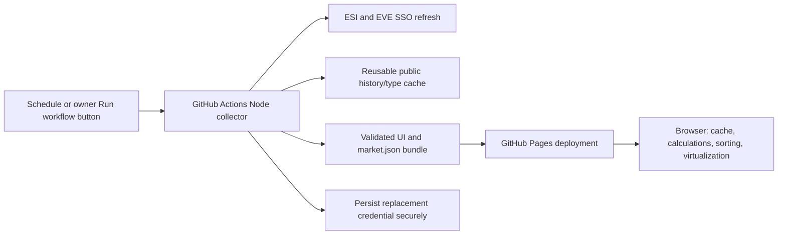

# GitHub-only snapshots versus Cloudflare

Evaluation date: **2026-11-06**. [Discovery index](README.md).

## Conclusion under the clarified requirements

**A GitHub Actions collector publishing JSON alongside the React app on GitHub Pages is a credible production architecture for this workload. It is the first option I would prototype now.** That conclusion follows from the clarified requirements: public snapshots are acceptable, one owner character can access both structures, updates may be hours apart, and persistent market history is unnecessary. A serving API, viewer sessions, and a relational database are no longer baseline requirements.

Cloudflare remains competitive, especially for better cache/header control, independent object updates, private or multi-user access later, or collection independent of GitHub schedules. However, its simplest fair comparison is now **Actions + Cloudflare Static Assets**, not necessarily the earlier Workers/D1/private-R2 design. Both providers can serve this application statically.

The outstanding technical gate for GitHub-only is **durable refresh-token handling**, plus measuring end-to-end ESI collection and history fan-out. Neither data size nor a need for SQL currently establishes an advantage for Cloudflare.

## Updated workload and evidence

- Approximately **20,000 small rows per hub**, or **60,000 combined**, for Jita, Tortuga/Siseide and C-J6MT.
- Hourly refresh preferred; six- or eight-hour refresh acceptable; daily possible but less desirable.
- One owner's character can collect both private structures. Public distribution of the derived market snapshots is explicitly acceptable.
- Latest snapshot only. Small reusable reference/history caches are useful, without keeping a market time series.
- The owner's measured ingest time is tens of milliseconds for 20,000 rows. This is useful evidence about the measured path; the full ESI network/history pipeline has not been timed here.

A synthetic sizing exercise generated three 20,000-row hub arrays, with a shared pattern of item names and either four or ten numeric fields per row. Local Node `18.19.1`, five parses per variant:

| Variant | Raw UTF-8 JSON | Gzip representation | Median `JSON.parse` |
| --- | ---: | ---: | ---: |
| Name + 4 numeric fields | 7,867,448 bytes | 1,400,728 bytes | 13.67 ms |
| Name + 10 numeric fields | 16,019,831 bytes | 3,122,912 bytes | 23.83 ms |

These are **synthetic measurements**, not real EVE payload sizes, browser benchmarks, memory measurements, or a promise that Pages will transfer the gzip sizes. They support feasibility, not exact capacity claims. Actual names, decimal precision, schema and compression affect size. Parsed objects, JSON text, derived rows and sorting buffers all occupy memory; verify on a representative browser, especially if mobile matters.

Keep `type_id` alongside names. A common catalog of 20,000 names/volumes plus hub quote maps can reduce duplication, but a straightforward combined JSON file is a reasonable first implementation. Preserve the existing virtualized rendering and memoized derivation: fitting in memory does not mean rendering 60,000 DOM rows is cheap.

## What “store it in Pages” means

**Yes: put generated data in the Pages deployment artifact, without committing it.** Build a directory like this on the runner:

```text
dist/
  index.html
  assets/...
  data/market.json
```

Then upload that directory with `actions/upload-pages-artifact` and publish it with `actions/deploy-pages`. The browser fetches `./data/market.json` under the app's Vite base path. Our existing workflow already uses this artifact/deploy mechanism. GitHub documents custom-workflow publication independently of a generated-files branch. [Pages custom workflows](https://docs.github.com/en/pages/getting-started-with-github-pages/using-custom-workflows-with-github-pages).

Pages is the published static site, **not a mutable storage bucket with an upload-one-object API**. A refresh creates a new complete deployment containing UI and data. A separate data-only deployment to the same site would replace the site bundle rather than append a file. Use one publishing workflow for scheduled refreshes, source releases and manual runs, or ensure every publishing path assembles the entire intended bundle.



### Storage choices

| Location | Appropriate use | Tradeoff |
| --- | --- | --- |
| **Pages deployment artifact/site** | Browser-facing current market snapshot. Preferred starting point. | Requires a full site deployment for updates; no per-file write service. |
| Main repository or generated-data branch | Durable files addressable through Git. Technically works. | Replacing a file does not remove old Git versions; large generated snapshots accumulate history and noisy commits. Unnecessary here. |
| Ordinary Actions artifacts | Short-lived diagnostics, previous successful build, or workflow-to-workflow transfer. | Not a convenient anonymous JSON endpoint; downloads require GitHub access and artifacts expire. [Artifact downloads](https://docs.github.com/en/actions/how-tos/manage-workflow-runs/download-workflow-artifacts). |
| Actions cache | Rebuildable public regional-history/type metadata and ETags. | Evictable and immutable per cache key; not authoritative credential storage. |
| Release asset | A deliberately retained downloadable snapshot, if that later becomes desirable. | Additional publication/version-cleanup mechanics; little advantage for the current browser data path. |

Set short artifact retention explicitly and account for retained build artifacts separately from the one live Pages site. “Overwrite the live JSON” does not automatically imply that Actions retains no old build outputs. Do not upload credentials in the deployment or diagnostic artifacts.

## Collection, publication and browser caching

Proposed pipeline:

1. Serialize owner collection runs and read credentials **after** entering that serialized path.
2. Refresh the character token and persist a returned replacement immediately; do not wait for successful market collection or publication.
3. Fetch complete ESI books with pagination, cache/rate handling and bounded retries. Normalize approximately 20,000 output rows per hub. Raw order count and HTTP page count may exceed the output row count.
4. Restore/update public type metadata and regional-volume summaries separately from live quotes.
5. Validate schema, hub IDs, completeness, row counts and numeric values. A legitimate empty book is different from a failed/forbidden request.
6. Build the frontend and write a single public market envelope with `schemaVersion`, `generatedAt`, per-hub `observedAt`, source/strategy metadata and rows. Keep credentials in a separate directory that is never packaged.
7. Publish only a valid bundle. A failed collection leaves the previous Pages deployment serving its last good snapshot. Initially fail the complete refresh if either private hub is incomplete; later, explicitly stale per-hub fallback is optional.

A single JSON envelope gives each successful download an internally coherent set of hubs. It does not imply ESI collected all three books at the same instant; retain each timestamp. For breaking schema changes, maintain a compatibility window because cached frontend code and current data can briefly differ.

Fetch the stable file using a revalidating request such as `fetch(url, { cache: "no-cache" })` on app load and when the user requests updated data. Retain the last successful object in memory; IndexedDB is optional for offline/revisit use. Display collection time and stale status. HTTP/browser/CDN caching can add delay, so measure the published URL's headers and propagation rather than promising an exact freshness bound. A stale-data message should survive collection failures and disabled schedules.

At this cadence, start with one file. If repeat downloads become significant, introduce a tiny revalidated manifest and content-hashed snapshot files, retaining a previous generation briefly to handle clients that fetched an older manifest. That is a delivery detail, not a requirement for historical analytics.

**Two different buttons:** “Reload latest published snapshot” is a normal public browser fetch. “Collect new ESI data” is a privileged job trigger. An owner can use GitHub's Run workflow button or CLI. Do not embed a repository write token in the public app to let everyone dispatch jobs. The dispatch API requires suitable authorization. [Workflow dispatch API](https://docs.github.com/en/rest/actions/workflows#create-a-workflow-dispatch-event).

## Credential setup can be local, but the stored state must be maintainable

One interactive EVE login during setup is reasonable. Use a small **local OAuth bootstrap command** with a registered callback, obtain the character grant, validate both structures and put the resulting refresh token in Actions secrets. The deployed static website does not need a permanent OAuth callback or visitor login. Keep the EVE application's confidential-client secret in Actions secrets as well. No EVE account password should be stored. [EVE SSO](https://developers.eveonline.com/docs/services/sso/).

The access token is short-lived; the refresh token is the persistent grant. It may allow unattended collection for a long time, but revocation, scope/app changes or access loss can require reconnection. The refresh response can contain a different refresh token: preserve the latest returned value rather than assuming the initial secret remains valid forever. [Official token-refresh guide, archived](https://docs.esi.evetech.net/docs/sso/refreshing_access_tokens.html).

**GitHub secrets are writable through the API, but a normal workflow's `GITHUB_TOKEN` does not have a `secrets: write` permission.** Repository-secret updates require a suitable GitHub App installation token or fine-grained PAT with repository Secrets write permission. `contents: write` does not grant it. [Secret update API](https://docs.github.com/en/rest/actions/secrets#create-or-update-a-repository-secret), [workflow permission list](https://docs.github.com/en/actions/reference/workflows-and-actions/workflow-syntax#permissions).

Two GitHub-only ways to resolve this:

- **Write back to an Actions secret.** Install a GitHub App restricted to this repository with the necessary secret-update permission, mint its short-lived installation token during collection, and save any replacement EVE refresh token. Prefer an environment secret for the mutable token to address queued-run timing, as explained below; its update API requires repository **Environments write**, rather than the **Secrets write** required for repository secrets. A fine-grained PAT can bootstrap a small prototype, but its expiry becomes a maintenance dependency. This avoids committing even encrypted EVE grants, at the cost of another service credential/App setup. [Environment secret update API](https://docs.github.com/en/rest/actions/secrets#create-or-update-an-environment-secret).
- **Store a small encrypted grant record on a dedicated state branch.** Use authenticated encryption and a random encryption key held in Actions secrets; update the ciphertext with `contents: write`. This avoids a separate secret-writing App/PAT, but introduces encryption/key handling, commit/version concurrency, and a branch containing tiny historical ciphertext versions. It is quite different in size from committing market snapshots, but is still persistent state in Git. Never publish plaintext, and never restore an old credential merely because market data is rolled back.

Choose one approach before claiming a fully unattended implementation. Initially use one collector job for refresh, durable write-back, collection and deploy. Prevent overlapping manual/scheduled runs and fetch the current secret/state after serialization, not at an earlier queued workflow stage. Test token replacement, cancellation and write-back failure. Because token issuance and storage cannot share a transaction, a crash between them can still require reconnection; this is not unique to GitHub.

There is a specific GitHub timing issue: **repository secrets are read when the workflow is queued; environment secrets are read when the referencing job starts**. Serializing a workflow does not by itself refresh a repository secret already captured at queue time. For the secret-backed approach, use an environment secret read by the serialized collector job, update that same environment secret, and test two queued/manual runs. For encrypted Git state, read the current state branch after acquiring the execution slot. The secret REST API cannot return a plaintext secret to work around a stale value. [Secret-read timing](https://docs.github.com/en/actions/reference/security/secrets#when-github-actions-reads-secrets).

**Do not use Actions cache as the sole copy of a refresh token.** It is evictable, and caches can be exposed to PR workflows. A rebuildable public-data cache is appropriate; a long-lived credential is not. [Actions caching rules](https://docs.github.com/en/actions/reference/workflows-and-actions/dependency-caching).

Cloudflare makes mutable encrypted credential storage more natural if a backend/database is retained, but still needs a key, storage credentials, serialization and recovery. A purely static Cloudflare deployment with an Actions collector has the same EVE credential lifecycle as the GitHub-only version; changing the CDN does not solve token persistence.

## ESI history caching is useful and supported

ESI's cache headers describe **when to recheck upstream**, not a command to delete the copy already downloaded. Retain responses/ETags, wait until the upstream cache is eligible, then revalidate; a `304` lets the collector reuse its copy. A six- or eight-hour market snapshot is simply less fresh data, not a cache violation. [ESI cache guidance](https://developers.eveonline.com/docs/services/esi/best-practices/#caching).

For weekly regional volume, store compact records keyed by `(regionId, typeId, completedUtcDateWindow)`, with fetched time, summary value, ETag if keeping the response body, and provenance. The reviewed market-history route expires daily at 11:05 UTC. Refresh eligible history once daily after that update, rather than once per hourly price job. The current schema has region/type parameters, not a structure-sales query. [Official OpenAPI specification](https://esi.evetech.net/meta/openapi.json), [API limitations already documented](01-eve-api-and-authentication.md#weekly-volume-and-profit).

The significant issue is **fan-out**: 20,000 tracked types across three distinct regions could require approximately **60,000 history requests** for an initial or full daily refresh. This is not a measured need: the real type universe and number of regions must be verified, and duplicate region/type requests should be shared. Caching helps subsequent hourly runs but does not make a complete daily re-fetch into one request. Start with active/relevant candidates and a bounded, resumable history job if that fan-out is large. Never advance a seven-day window by inventing missing days.

Persist the small seven-day summaries in the published snapshot so subsequent runs can recover them from the known public URL; alternatively restore them from an Actions cache keyed by version/date/run with a fallback prefix. Validate either source. A cache miss triggers bounded rebuilding and an explicit unavailable/stale metric, not false zero demand. Larger raw historical responses can remain an optional evictable cache. No market-order history database is needed.

Regional volume is still **regional**, not verified Tortuga/C-J6MT weekly sales. This limitation is identical on both hosting platforms.

## Costs, limits and freshness

Pages currently permits a 1 GB published site and has a soft 100 GB/month bandwidth limit. The soft ten-builds/hour limit does not apply to custom Actions publication. A roughly 8–16 MB current payload fits comfortably; readership and transfer encoding determine bandwidth. For scale: 10,000 full downloads at 16 MB would be about 160 GB before compression, while 1,000 would be 16 GB. [Pages limits](https://docs.github.com/en/pages/getting-started-with-github-pages/github-pages-limits).

Standard hosted Actions runners in public repositories are currently free. Private-repository compute and retained storage need account-specific allowance checks; a public Pages workflow is the simplest route to the stated $0 target. [Actions billing](https://docs.github.com/en/billing/concepts/product-billing/github-actions). Workload planning, using 30 days and **total** collector/build/deploy time:

| Cadence | Runs/month | At 1 minute/run | At 3 minutes/run |
| --- | ---: | ---: | ---: |
| Hourly | 720 | 720 runner-minutes | 2,160 runner-minutes |
| Every 6 hours | 120 | 120 | 360 |
| Every 8 hours | 90 | 90 | 270 |
| Daily | 30 | 30 | 90 |

These are elapsed workload estimates, not a private-account bill or the measured tens-of-milliseconds row-ingest time. Check retained artifact bytes separately and use short retention.

Use a schedule such as `17 * * * *`, `17 */6 * * *`, or `17 */8 * * *`. Scheduled runs can be late or dropped; public-repository scheduling can disable after 60 days of inactivity. Do not assume publishing without source commits satisfies that activity condition. Show data age and document an owner recovery/check routine. [Schedule behavior](https://docs.github.com/en/actions/reference/workflows-and-actions/events-that-trigger-workflows#schedule).

This scheduling weakness also affects **Cloudflare + Actions**. Cloudflare gains an independent timer only if collection moves to Cloudflare Cron or another scheduler. That must be evaluated separately: Workers Free CPU and subrequest limits do not automatically accommodate the measured ingest plus all network-page processing. [Workers limits](https://developers.cloudflare.com/workers/platform/limits/).

## Comparison on equal requirements

| Consideration | GitHub Actions + Pages | Cloudflare static assets / objects + Actions | Earlier Worker + D1 + private R2 design |
| --- | --- | --- | --- |
| Small public dataset | Natural fit. | Also natural fit; no database required. | Works, but much of its machinery serves requirements now removed. |
| Live data update | Complete Pages bundle publication. | Static bundle redeploy, or independent R2 object writes if using storage. | Independent object/manifest updates. |
| Credential state | Secret write-back App/PAT or encrypted Git state. | Same issue if collection/credentials remain in Actions. | Mutable encrypted store is easier to integrate, but still requires lifecycle code. |
| Local testing | Node collector + fixture JSON + existing Vite; simple file-output contract. | Same Node collector; Cloudflare tooling for final hosting behavior. | Also test backend, bindings, database and access controls. |
| Browser caching | Works; less delivery/header control. | More explicit static headers and delivery control. | Programmatic response/access behavior. |
| Immediate collection | Owner workflow button/CLI; public browser reloads published data. | Same with Actions; optional protected trigger service. | Protected request/job API can provide it. |
| Schedule reliability | GitHub best effort/inactivity behavior. | Same if using Actions. | Can change if using provider-native scheduling, subject to limits. |
| Viewer privacy / individual OAuth | Requires architectural expansion if added later. | Requires a backend/access layer if added later. | Designed for those features. |
| Service/account count | Existing GitHub project; possibly an additional GitHub App. | Adds Cloudflare account/deploy credentials, optionally R2 subscription. | More resources, secrets and operational surfaces. |
| Growth/traffic | Pages site/bandwidth boundaries; full download per version. | Stronger delivery controls and object options. | Can introduce server filtering, but only when needed. |

Cloudflare static asset requests can be free without dynamic Worker execution, and custom asset headers are supported. Thus it would be unfair to charge the simplified Cloudflare version for a Worker API/database it does not need. Similarly, it would be unfair to compare public Pages against mandatory private R2 when public snapshots are accepted. [Cloudflare pricing](https://developers.cloudflare.com/workers/platform/pricing/), [static headers](https://developers.cloudflare.com/workers/static-assets/headers/).

## Recommended next experiment

Prototype **GitHub-only**, because the repository already deploys Pages and the clarified requirements fit a static publisher. Begin hourly; reduce to six/eight hours only if actual collection, publication or account budgets justify it. This is an evaluation result, not authorization to provision credentials or deploy a replacement now.

Before selection, demonstrate:

1. A local collector writes the same sanitized JSON envelope consumed by Vite, without an API server. A fixture run needs no credentials.
2. One authorized EVE grant can fetch both complete structure books, and measured end-to-end time includes pagination/history work.
3. A replaced refresh token survives the next run, a failed publish and a serialized manual run, without relying on cache retention.
4. One staging Pages workflow publishes UI and data without committing market files; failed collection leaves the previous snapshot available.
5. Browser parsing/calculations, refresh/cache behavior, deployment propagation and displayed timestamps are acceptable on the target device.
6. Regional-volume collection has a measured request budget and honest scope/missing-data behavior.

If those pass, **there is no current functional need for a Cloudflare backend or a formal database**. Keep collection, file generation and publishing as separate code boundaries so moving the same `dist` payload to Cloudflare later stays straightforward. Revisit Cloudflare when a measured delivery constraint, credential-state maintenance burden, privacy requirement or reliable interactive refresh requirement outweighs the extra hosting integration.
