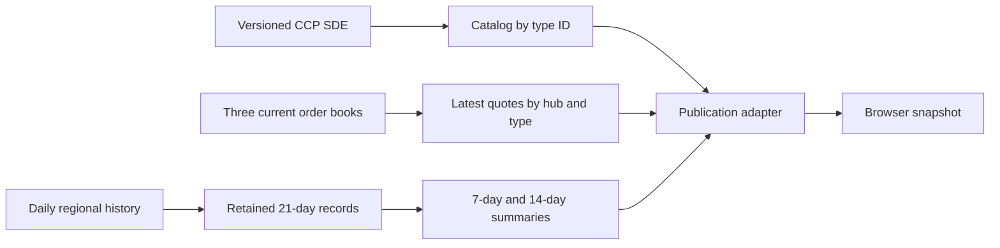

# Backend scaffold: catalog pipeline and data-model discussion

2026-11-07. This is a focused data-model spike. The catalog updater and bounded collection concurrency run now; the proposed quote/history file layout and replacement browser payload are still for review. [Run commands](../../apps/market-backend/README.md). [Earlier proof decisions](05-local-proof-decisions.md).

The subsequent [storage measurements and decision](07-storage-performance.md) compare complete local processing pipelines. The current direction is split compact JSON state, prepared summaries for price-only jobs, and transient raw orders reduced to competition aggregates. SQLite remains an alternative for future keyed history updates.

The persistent history implementation, current file layout, table integration and operational tests now live in [the lifecycle report](08-history-lifecycle.md). The design discussion below records the earlier spike.

## Confirmed direction

- GitHub-only remains the intended hosted system; implementation and validation are local for now.
- The concept is proven. New work lives under `apps/market-backend`, with `backend:*` commands. Old commands and connected local state remain compatible.
- Retain **21 completed UTC calendar days** of regional history. Seven days is the default analysis window; fourteen days is a possible later choice.
- Keep daily traded volume, average/high/low prices and order count.
- A few days of older history can still be useful. Store freshness and coverage explicitly. Defer history warning thresholds and presentation to UI/UX work.
- Static catalog, current prices and daily history have independent update cycles.
- Defer GitHub workflows, production frontend changes and the full daily history collector until the storage model is discussed.

## Think of four small tables

The important separation is what a thing **is**, what orders exist **now**, what traded on each **day**, and what file the **browser** reads. JSON can represent tables; choosing these identities does not require SQL.

| Dataset | Identity/key | Contents | Changes when |
| --- | --- | --- | --- |
| Catalog | `typeId` | English name, ordinary/packaged volume, group, market group, published flag | Relevant SDE fields change. |
| Hub directory | `hubId` | Label, station/structure location ID, system and region | Hub configuration changes. |
| Latest quotes | `(hubId, typeId)` | Best buy/sell prices, units on each side, observation/provenance | We refresh order books. |
| Daily regional history | `(regionId, typeId, UTC date)` | Volume, average/high/low price, order count | A daily record arrives or is corrected. |

These keys answer different questions. A type ID identifies an item regardless of renaming. A location identifies a particular hub. A region identifies the geographic scope of ESI's history. **Regional history is not Tortuga's own sales history**, even when displayed beside Tortuga's current price.



For example, the catalog knows that type `587` is a Rifter and its packaged volume is 2,500 m³. A quote record only needs `587` and current market numbers. The application can join them by that ID instead of maintaining a separate Rifter name/volume for every hub.

## Catalog: implemented storage and update procedure

The compact catalog is a dictionary. This is an actual imported type, abbreviated to one row:

```json
{
  "schemaVersion": 1,
  "types": {
    "587": {
      "name": "Rifter",
      "groupId": 25,
      "marketGroupId": 64,
      "published": true,
      "volumeM3": 27289,
      "packagedVolumeM3": 2500
    }
  }
}
```

Ordinary volume and packaged volume are different fields. Keeping both prevents an import from silently confusing an assembled ship with its packaged form. Zero is a valid value for volume; null means unavailable. Positive unpublished type IDs are retained, while CCP's reserved zero type is excluded. The 53,305-definition catalog includes internal/unpublished definitions; full market coverage still selects types actually quoted at one of the configured hubs.

Two files have different responsibilities:

```text
catalog/current.json                  small active-version manifest
catalog/types-<content-sha256>.json    catalog contents
```

The manifest records the CCP build, source release/import times, URL/member, CRC32, SHA-256, count and data filename. The data filename depends on the selected content. Names/volume/group fields changing produces a new file; an SDE build changing only discarded fields can reuse the old file. Write and validate contents first, then atomically switch the manifest. Readers see either the old valid catalog or the new valid catalog.

The reusable update command is:

```text
npm run backend:catalog
```

It checks [CCP's latest build metadata](https://developers.eveonline.com/docs/services/static-data/), compares the installed build, and stops if unchanged. Otherwise it uses HTTP byte ranges to retrieve only `types.jsonl` from the pinned archive, streams decompression, checks declared size/CRC32, imports selected fields, validates them and switches the manifest. A manual Action and a daily version-check Action can eventually call the same command. No assumption about six-week releases is required. It cannot silently conclude that a changed build is irrelevant; it compares the imported content hash.

The real import was run successfully against build **3670638**, released **2026-11-04**:

| Measurement | Result |
| --- | ---: |
| Catalog definitions | 53,305 |
| Compact catalog bytes | 7,609,392 |
| Archive bytes transferred | 23,656,851 |
| Whole archive size | 99,305,880 |
| Archive range requests | 4 |
| Next updater invocation | `up_to_date`; version metadata only, no member download |

The stream validates CCP's current ZIP format without a package install. Unsupported ZIP64/encryption/range behavior fails with the old catalog intact. This is deliberately a small SDE reader, not a general-purpose archive extractor. `--force` repairs damaged local data; `--check` only compares available and installed versions.

## Quotes: proposed canonical representation

The existing viewer gets repeated item names/volumes under each hub. That remains a working publication format, but the backend can keep a cleaner canonical representation:

```json
{
  "hubId": "tortuga",
  "locationId": "1056332656965",
  "regionId": "10000030",
  "observedAt": "2026-11-07T12:00:00Z",
  "quotes": {
    "587": {
      "bid": 1000000,
      "ask": 1200000,
      "buyUnits": 20,
      "sellUnits": 35
    }
  }
}
```

The quote prices and counts above are invented examples. The Siseide region is Heimatar (`10000030`). `bid` means the highest existing buy order; `ask` means the lowest existing sell order. Buying goods normally pays the source's ask; selling immediately receives the destination's bid. Comparing with a destination ask estimates listing competition. Total side units are not all executable at the best price.

With a dictionary lookup, a missing quote can mean no available book entry without duplicating a complete catalog under every hub. Whether to use absent keys or explicit null quote records in the *published* file is still open; the backend must preserve the difference between an unavailable price and a zero price.

The owner has settled quote depth: this tool spots ask-to-ask arbitrage over shipping times, rather than estimating immediate execution for a specified quantity. Retain best prices and aggregate stock, process individual orders transiently, and discard the book. Do not store per-order history or price levels.

The collector now persists an aggregate-only book cache, with a separate `competitionAsOf` timestamp and these per-item fields:

```json
{
  "askOrders": 12,
  "recentAskOrders24h": 3,
  "recentAskUnits24h": 180,
  "recentAskOriginalUnits24h": 250,
  "unknownIssuedAskOrders": 0
}
```

Counts above are examples. They use ESI `issued` directly, with an inclusive 24-hour boundary, rather than guessing original duration from remaining time. Missing/future timestamps leave recent metrics unknown. Current remaining units and original listed units have different meanings; neither proves how much was newly imported. One seller can have multiple orders, and seller identity is not exposed by this book. The exact repricing behavior of `issued` needs a controlled owner check before calling it a definitive last-update timestamp. Recent ask activity is a useful competition proxy meanwhile.

The intended opportunity estimate is `(destination ask after sale expenses − Jita ask − packaged-volume shipping) × weekly-equivalent regional volume`. The derived library now exposes that weekly estimate separately from unit profit. It remains a regional demand proxy. For a fourteen-day window, use half the volume as the weekly-equivalent flow so changing the window does not simply double the score.

## History: 21-day model and independent freshness

The shared history helpers are implemented and tested; the full daily refresh/persistence job is not. A per-region/type series has this shape:

```json
{
  "schemaVersion": 1,
  "regionId": "10000002",
  "typeId": "587",
  "retentionDays": 21,
  "asOfDate": "2026-11-06",
  "checkedAt": "2026-11-07T12:00:00Z",
  "expiresAt": "2026-11-08T11:05:00Z",
  "lastRecordDate": "2026-11-06",
  "days": {
    "2026-11-06": {
      "volume": 100,
      "orderCount": 15,
      "average": 1100000,
      "highest": 1250000,
      "lowest": 950000
    }
  }
}
```

Numbers/times above illustrate the shape. Retention means **21 calendar days ending at the last validated coverage date**, not the last 21 rows or trades. Repeated dates replace existing records. Corrections to any returned retained date are reconciled. Failed attempts should leave the last successful series intact. A stale series remains usable and honestly dated; merely opening the viewer must not shift it forward and discard data.

The timestamps answer separate questions:

- `checkedAt`: when a successful source check occurred.
- `asOfDate`: the completed-day coverage window the refresher has established. The future refresher must derive it from validated feed coverage, not invent it from the computer's current date.
- `lastRecordDate`: the newest actual daily record. An illiquid item may have an older last record even after a successful check.
- `expiresAt`: when ESI says another source refresh is eligible.
- Quote `observedAt`: current book age, independent of the history above.

The seven-day default summary and optional fourteen-day summary are calculated from daily volume. They include their window dates, missing dates, source check time and coverage lag; they do not contain an instruction to show a UI warning. Missing dates currently produce unknown volume, not invented zero trading. Whether absence can be treated as confirmed no-trade data needs feed-specific verification before changing that policy.

The [current ESI specification](https://esi.evetech.net/meta/openapi.json) offers one history response per region/type with no date-range selector. Keeping only 21 days shrinks our retained state; it does not turn the upstream response into a 21-day or three-day delta. Refreshing daily remains separate from frequently refreshing prices.

## File layout and why internal storage can differ from browser data

Recommended layout for review:

```text
catalog/                            implemented
  current.json
  types-<sha256>.json
quotes/                             proposed
  <hubId>.json                      latest normalized quote book
history/                            proposed
  <regionId>.json                   region file, series keyed by typeId
public/data/market.json              current publication adapter output
private/                            existing credentials/configuration
```

Three region files avoid creating tens of thousands of tiny history files. They can be independently updated/restored and compressed as workflow artifacts. A partial refresh needs per-type provenance, not one misleading timestamp for a whole region. The measurements favor compact JSON row arrays plus explicit column/schema metadata for large daily tables, rather than repeating object field names for each observation. The readable series example above is the logical model; it does not require identical physical serialization. SQLite remains an alternative for keyed updates, partial refreshes and transactions. Its serving/history state should be split too if artifact restore becomes material.

At the upper-bound example of 20,000 types × three regions × 21 days, history can contain **1,260,000 daily records**. That is much larger than 60,000 current quote rows. Therefore keep the full retained history as backend state and publish 7/14-day summaries unless a browser chart needs the raw days. A catalog can be shared between hubs; the browser does not need every internal/unpublished type.

The publication adapter can still produce one downloadable JSON file, preserving the original static-browser concept while canonical backend files evolve. A later version can include shared item metadata, quotes by hub, summaries by region/type and independent provenance. Publish a validated generation atomically so the browser does not combine different catalog/quote versions. Daily history state and private grants are not accidentally included just because they share a state directory.

## Parallelism: implemented limits and implications for the model

All three hubs can collect concurrently. Each discovers its page total, then uses at most two page workers. A shared limiter allows at most three ESI HTTP operations overall, including response parsing and cache writes. Thus the maximum is **three**, not three hubs multiplied by two pages. Cached pages do not consume network slots. This is a starting policy, not a claim that CCP permits any fixed requests-per-second rate. Header-driven cache/rate/error handling stays in place. [ESI best practices](https://developers.eveonline.com/docs/services/esi/best-practices/).

Workers preserve input/page order for deterministic aggregation. A failed required request stops queued network work, and in-flight workers finish before the operation returns and releases its lock. Concurrent progress is a list keyed by hub, plus aggregate page counts; one global current-hub counter would lose information.

Metadata lookup is now local. The daily history job can reuse the same limiter later, but should be independently resumable with per-region/type success timestamps. Do not hold fresh quote publication hostage to old history. Do not run overlapping token-refresh jobs without the existing serialized grant handling.

## Decisions recorded for this spike

| Choice | Decision | Alternative considered |
| --- | --- | --- |
| Runtime/source location | Promote to `apps/market-backend`; native Node; old commands remain aliases. | Rewrite into a new framework or install dependencies before the model is reviewed. |
| Existing state | Continue `.market-poc` if it exists; new installs use `.market-backend`. | Automatically move login files or make the owner reconnect. |
| Catalog source | Official CCP JSONL types member, build check plus normalized content hash. | Thousands of per-type ESI lookups, hardcoded patch cadence, or adopting a third-party data dependency. |
| Packaging | Stream a selected ZIP member using Node built-ins and verify it. | Install a ZIP package/Python dependency, or download/extract the full archive. |
| Catalog activation | Immutable content-addressed data and an atomic manifest pointer. | Overwrite a live partially written catalog. |
| History retention | 21 completed UTC calendar days; volume, price statistics and order count. | Volume-only summaries or a hardcoded seven-day retention window. |
| History UX | Keep check-age, coverage and quote freshness separate. Seven-day default. Defer warnings. | Couple all source freshness to file generation time or assign new warning thresholds now. |
| Concurrency | Three total HTTP slots; two page workers per hub; three hub workers. | Completely sequential work or unbounded Promise.all over hundreds of pages. |
| Next architecture work | Review quote granularity and publication shape before implementing daily history orchestration/Actions/frontend. | Build the remaining app around the first viewer's duplicated row format. |

## Validation and remaining discussion

`npm run backend:test` passes **38 tests** covering the prior auth/viewer pipeline plus catalog range/CRC/hash validation, version skip/reuse/repair, failed-update preservation, no per-type ESI lookups, global/per-hub concurrency limits, fatal-response queue stopping, worker draining and 21-day history reductions/corrections/coverage. The real SDE import and unchanged-build check succeeded. Installed Chrome also passed the updated temporary mock-preview checks, including parallel hub/page progress, reload recovery, all collection stages, age updates and mobile layout with 60,000 fixture rows. The new full private-book collector has not been timed against live EVE after this change.

For the next implementation slice, finalize how the published file joins shared catalog, hub quotes and regional summaries. The daily history fetcher, durable GitHub state/credentials, workflows and production frontend remain separate next slices.

Order-depth retention is now resolved as described above. The [project checklist](../../TODO.md) is the authoritative remaining-work list; the [performance report](07-storage-performance.md) records the chosen direction, measured alternatives and limitations.
