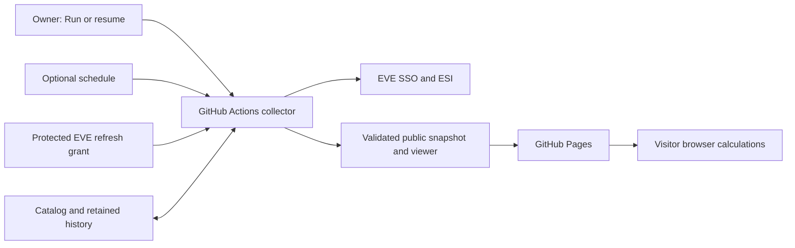

# Jita/C-J6MT closeout, GitHub deployment and dormancy

Planning date: 2026-11-16. Tortuga in Siseide is retired. The local collector now defaults to Jita and C-J6MT. This document separates the implemented hub fix from deployment choices awaiting the owner's decisions. New collection/deployment workflows have not been enabled.

## Implemented and ready to review

- A saved Tortuga ID no longer enables that hub. `tortugaEnabled` defaults to false, including for older local configuration files.
- Jita and C-J6MT remain required. Enabled optional structures returning 403/404 during metadata lookup or order collection are omitted with a public diagnostic; those failures cannot stop the other hubs' request queue. Authentication failures and global rate limits still stop collection.
- Required-hub failures retain the previous valid public snapshot. Failed optional hubs do not contribute stale quotes or history targets to the new snapshot.
- The snapshot and viewer accept variable hub lists, including old three-hub snapshots. Route selectors and page/hub progress derive from the current dataset. Jita → C-J6MT remains the default route.
- Additional hubs can be added through configuration; no table rewrite is needed. Numeric structure identity and character access are verified through ESI. An optional expected system can catch configuration errors.
- The old `.github/workflows/deploy-pages.yml` now has manual dispatch only. It still deploys the **legacy React scraper app backed by Deno**, not this collector/viewer. Removing its automatic push trigger prevents a source commit from accidentally publishing that old application. The replacement workflow is a decision for the next phase.
- Local editor swap files are ignored; private configuration, grants, catalog/history/cache state and generated snapshots remain ignored. No commit, push or hosting change was performed.

Optional future hub entry in the ignored local `private/config.json` (replace the placeholders):

```json
{
  "additionalHubs": [
    {
      "id": "deployment",
      "name": "Next deployment",
      "structureId": "NEW_NUMERIC_STRUCTURE_ID",
      "expectedSystem": "NEW_SYSTEM_NAME",
      "enabled": true,
      "required": false
    }
  ]
}
```

This is an entry added to the existing configuration, not a replacement for the client/contact/C-J6MT settings. The setup form preserves additional entries. A future committed nonsecret hub-configuration file can use the same definitions once we select the runner bootstrap format. Hub IDs must be unique; names, system names and structure IDs are not credentials.

## Local validation

All 71 backend tests passed, including optional-hub metadata/book 403/404 cases, required-hub rollback, future hub configuration and legacy snapshot compatibility. Installed Chrome passed two-hub routing, automatic future-hub options, fallback after a hub is removed, legacy data, settings and mobile checks.

A real prices-only run authenticated successfully and fetched both live books, then correctly stopped on new type `95629` missing from the old SDE. After updating the catalog to build **3698585** (**53,924 types**), the real two-hub refresh succeeded in **33.6 seconds**, issuing **468 ESI requests** with **3 cache hits** and publishing **19,258 rows per active hub**. This is why the resume workflow begins with the SDE updater. The new public snapshot omits Tortuga; retained history was reused rather than launching an automatic backfill.

**2026-11-17 follow-up:** [Document 11](11-github-only-auth-feasibility.md) supersedes the browser-feasibility uncertainty below: credential-free Chrome tests passed. It proposes Pages/browser PKCE plus separately authorized GitHub Secret writes, with environment Secrets for job-start grant loading. Full hosted integration remains untested.

## Clarification: Connect EVE on the hosted website

The owner now requires users to authorize EVE through the live application, as they can through the local UI. The earlier proposal in this document assumed **local initial authorization followed by hosted refreshes**. That does not, by itself, deliver hosted sign-in.

Three responsibilities must be distinguished:

1. **EVE application/SSO:** authorizes a character and issues the EVE grant.
2. **Hosted callback/token broker:** receives the sign-in result, exchanges/verifies it, checks who may replace a collector grant, and saves it privately.
3. **GitHub App:** an optional GitHub machine identity allowed to write Actions Secrets. Registering it does not host the callback or run our server code.

Pages is static hosting. If a hosted Connect flow authenticates the user only to EVE, keeping grants centrally in GitHub Secrets needs a trusted component with GitHub write authority. A small hosted backend is the conventional solution, but it is not an unconditional requirement of OAuth itself. The writer can be a GitHub App or a scoped personal token; the latter removes App setup but introduces token maintenance. Never ship that writer credential to the public browser. [Pages](https://docs.github.com/en/pages/getting-started-with-github-pages/what-is-github-pages), [GitHub App code still needs a runtime](https://docs.github.com/en/apps/creating-github-apps/about-creating-github-apps/about-creating-github-apps), [Secret writer permissions](https://docs.github.com/en/rest/actions/secrets#create-or-update-a-repository-secret).

Alternative worth evaluating: Pages + a small hosted OAuth/token broker with its own private durable token store, while Actions retains catalog/market/history processing. The broker persists replacement EVE grants itself. Actions authenticates to the broker, potentially using verified GitHub OIDC identity, instead of writing repository Secrets. This removes the GitHub App/Secret-writer requirement and relaxes GitHub-only hosting for the authentication component. It requires a properly designed broker authorization and storage boundary, not a public token endpoint.

A serverless runtime such as Cloudflare Workers is one candidate; Workers and SQLite-backed Durable Objects offer free-plan allowances. Eligibility/capacity must be checked for the chosen implementation. Moving only OAuth/token handling is much smaller than porting the full Node ingestion backend. [Workers pricing](https://developers.cloudflare.com/workers/platform/pricing/), [Durable Objects pricing](https://developers.cloudflare.com/durable-objects/platform/pricing/).

A browser-only PKCE/collection design is a different product: it needs a separate EVE browser/CORS feasibility check and would not automatically give Actions a durable credential when the browser closes. It can be considered if unattended/shared collection is dropped. Actions alone is not a normal HTTP OAuth callback server.

A GitHub-only owner setup is also worth a focused feasibility check: the browser could potentially complete EVE PKCE and use explicitly supplied owner GitHub authorization to encrypt/store the grant through GitHub's REST API. The GitHub API supports browser CORS; EVE's browser token-exchange behavior still needs verification. This must not embed an App private key, personal token, or EVE application secret in published JavaScript. Later automatic grant updates could run inside Actions with an App key or scoped token kept in Secrets. That is an owner/admin flow with separate GitHub authorization, not a general EVE-only visitor login. [GitHub cross-origin API support](https://docs.github.com/en/rest/using-the-rest-api/using-cors-and-jsonp-to-make-cross-origin-requests).

Encrypted repository state is only a storage choice. It could use a separate state branch instead of changing application source, but it does not solve hosted sign-in or browser authorization to write that state.

Before choosing a store, clarify whether Connect EVE is for approved administrators supplying the **one shared collector dataset**, or for every visitor supplying an individual character and dataset. GitHub Secrets is viable for the former; the latter normally calls for per-user credential storage and access controls. No backend, GitHub App or new hosted sign-in flow has been created while this is being discussed.

## How a live GitHub-only site would work

GitHub Pages serves static files. Visitors load the published JSON into the browser; they do not receive the owner character's grant. Reloading the page reloads that snapshot. It does not start an EVE collection job. Owner refreshes are initiated from Actions, a schedule, or the local collector; the existing local setup controls do not become public production administration endpoints.



The initial owner login can remain the proven local PKCE flow. A runner subsequently refreshes that grant without an interactive browser. A valid grant from the existing PKCE registration should use its existing public-client refresh mechanism; it should not be silently changed to a secret-based flow. The client ID is public, the character refresh grant is private, and any confidential-client application secret is also private. Visitor logins are unnecessary for the agreed public snapshots.

CCP describes refresh grants as long-lived and usable until revoked. That supports dormancy, but it does not promise an application will work unchanged after every future patch. The collector already preserves any replacement refresh grant locally; we must explicitly decide its runner-side write-back mechanism. Do not assume that every refresh rotates the token, or that its value can never change. [Current EVE SSO documentation](https://developers.eveonline.com/docs/services/sso/), [CCP's historical token-change notice](https://developers.eveonline.com/blog/sso-endpoint-deprecations-2).

## Operating modes

| Mode | Proposed operation | Advantages | Costs / limitations |
| --- | --- | --- | --- |
| Dormant, manual only | Keep Pages enabled with the last dated snapshot. Disable collection schedules. Owner runs a resume workflow when needed. | Least upkeep and ESI traffic; suits long gaps between deployments. | Data is intentionally old; resumption may require reauthorization and a history backfill. |
| Light standby | Daily prices/history refresh and SDE check, with hard budgets. | Shorter catch-up when trading resumes; failures become visible sooner. | Uses compute/storage and needs attention when credentials or ESI change; an idle public repository's schedule can be disabled. |
| Active deployment | Prices every six hours initially; history at its daily expiry; SDE version checks before collection. Manual catch-up remains available. | Useful operational freshness without a permanent service. | More jobs; still a best-effort schedule rather than a real-time service. |

My default for this iteration is **manual-only while dormant**, with an explicit active-mode switch later. Keep the last snapshot clearly dated and retain the bootstrap/runbook. Avoid artificial keepalive commits merely to make a sleeping project look active.

Public repositories' scheduled workflows are automatically disabled after 60 days without repository activity. An explicit disable/re-enable step belongs in the runbook. Schedules can also be delayed; they are not a timing guarantee. [GitHub inactivity behavior](https://docs.github.com/en/actions/how-tos/manage-workflow-runs/disable-and-enable-workflows), [scheduled events](https://docs.github.com/en/actions/reference/workflows-and-actions/events-that-trigger-workflows#schedule).

## Credential options

| Approach | What is stored | Pros | Cons |
| --- | --- | --- | --- |
| Local EVE grant only | Grant stays on the owner's computer; only an explicitly public site bundle is published. | Smallest hosted credential footprint; existing login/refresh path already works. | Requires that computer and a manual publication path; not an unattended GitHub collector. |
| GitHub Actions Secret, manual recovery | Bootstrap grant in a repository/environment secret. Job uses it to refresh; owner reconnects and replaces it when unusable. | Smallest hosted setup; no extra GitHub writer credential. | Cannot promise unattended recovery if a replacement token is issued. The runner's updated local file disappears when the runner ends. Revocation always needs owner intervention. |
| Actions Secret with automatic write-back | Grant remains in Secrets; a dedicated GitHub App or scoped token updates it promptly if its value changes. | Durable credential updates, good separation from data snapshots. | Extra GitHub credential/registration and permissions; personal tokens can expire, while an App still needs key maintenance. |
| Encrypted grant in a dedicated state branch/repository | An authenticated encrypted grant file; encryption key in Actions Secrets. Same-repository writes can use the job's `GITHUB_TOKEN`. | Automatic durable updates without a personal token when using the same repository; small token-only state need not bloat data history. | Key/envelope/version handling; repository write permission; ciphertext remains visible/history-retained if the repository is public. A separate private state repository needs an App/token because the built-in token is scoped to its own repository. |

For automatic Secret updates, GitHub's API requires a token with repository **Secrets: write** permission. The normal workflow permission list does not provide that capability; adding `contents: write` is not a Secrets writer. Use a GitHub App or narrowly scoped credential for that variant. [Secrets API permissions](https://docs.github.com/en/rest/actions/secrets#create-or-update-a-repository-secret), [workflow permissions](https://docs.github.com/en/actions/reference/workflows-and-actions/workflow-syntax#permissions), [built-in token scope](https://docs.github.com/en/actions/concepts/security/github_token).

Whichever automatic store is chosen, write a changed grant back **immediately after refresh**, before a long quote/history job or a deployment can fail. The current local implementation already follows this ordering. Serialize grant/state writers and do not cancel a running writer in favor of a newer scheduled run. No store can prevent revocation or eliminate the failure gap between two external services; a local reauthorization procedure remains necessary.

Do not put plaintext grants in public branches, Pages artifacts, logs, or Actions caches. Public market snapshots do not imply permission to expose credentials. Plaintext grant values are never needed in browser code.

## Catalog/history state is a separate decision

The catalog and 21-day regional history can be rebuilt. The refresh grant cannot be recreated from public data.

| Backend state location | Strength | Tradeoff |
| --- | --- | --- |
| Actions cache plus bounded run artifacts | Simple, fast, good for active use. | Cache eviction/artifact expiry must be expected. A dormant restart may need to download the SDE and backfill history. Suitable only when this cold-start cost is acceptable. |
| Dedicated data branch/repository | Persists across long inactivity and can use GitHub-native access. | Repeated large data commits accumulate history. Needs an explicit retention/compaction policy; keep it separate from application source history. |
| Release assets or another durable GitHub-hosted bundle | Keeps large state out of source commits. | Adds upload/download/retention/version logic; release immutability settings affect whether an asset can be replaced. Do not choose this until the update/recovery rules are agreed. |

Never make an evictable cache the only credential store. Default cache eviction and artifact retention are reasons to design a cold-start path rather than assume state will survive months of disuse. [Cache reference](https://docs.github.com/en/actions/reference/workflows-and-actions/dependency-caching), [artifact retention](https://docs.github.com/en/organizations/managing-organization-settings/configuring-the-retention-period-for-github-actions-artifacts-and-logs-in-your-organization), [GitHub's cache security guidance](https://docs.github.com/en/actions/concepts/workflows-and-actions/dependency-caching).

Standard hosted runner compute is free for public repositories; private repositories draw from plan allowances. Artifact/cache storage is a separate budget. Pages under GitHub Free is available from public repositories; private collection with a public site may therefore use two repositories. This is why source visibility matters separately from the already accepted public market data. [Actions billing](https://docs.github.com/en/actions/concepts/billing-and-usage), [storage/compute billing](https://docs.github.com/en/billing/concepts/product-billing/github-actions), [Pages availability](https://docs.github.com/en/pages/configuring-a-custom-domain-for-your-github-pages-site/about-custom-domains-and-github-pages).

## Proposed workflow sketch — not yet implemented

Start with manual dispatch and a common runner entrypoint. A workflow can have modes `resume`, `quotes`, `history`, `catalog`, `publish`, with schedules calling the same entrypoint later.

```text
Trusted manual run / optional schedule
  1. Checkout reviewed source; use a supported, pinned Node LTS.
  2. Restore backend data; bootstrap the grant from the selected protected store.
  3. Check/update SDE using backend:catalog (cold start works without cache).
  4. Refresh character grant; persist a changed grant to the protected store.
  5. Fetch Jita and C-J6MT; optional unavailable hubs become diagnostics.
  6. Run only the configured number/time of 1,000-request history batches.
  7. Persist/checkpoint backend data even when later publication fails.
  8. Validate mode=live, required hubs and explicit public allowlist.
  9. Export viewer + market.json; upload Pages artifact; deploy.
 10. Write a short run summary with freshness, coverage, omitted hubs and recovery action.
```

Frequent quotes should not wait for a complete history catch-up. Publish fresh prices with dated summaries first, and let a separate bounded catch-up run finish demand coverage. A first resume can publish usable prices even if rebuilding history takes much longer.

Useful separation once the runner bootstrap/store is proven:

- **CI on pushes/PRs:** dependency-free backend tests, synthetic exports, contracts and public-file checks. No EVE credentials for untrusted contributions.
- **Owner refresh workflow:** manual initially; collects/persists state and publishes the site. Credential/state writers share a concurrency group with cancellation disabled.
- **History catch-up:** explicit batch/time budget; persists progress for another dispatch. Existing `backend:history` is bounded; `--all` is not an appropriate default scheduled job until a job-wide bound is added.
- **SDE update:** shared updater, manual or a lightweight daily version check in active mode. No duplicated importer in YAML.
- **Pages publication:** explicit allowlist; never publish a fresh-start synthetic fixture as production merely because export succeeded. Retain the last deployed valid generation when collection fails.

Existing CLI commands provide much of the processing, but runner secret/state bootstrap, remote grant write-back, bounded workflow orchestration and the new Pages workflow are still missing. The current local UI cannot silently become a secure public "Run Action" button; owner dispatch should initially stay in GitHub.

## Commit and mothball checklist

1. Run `npm run backend:test`; review the optional-hub regression and browser checks.
2. Run `npm run backend:catalog`, then `npm run backend:quotes` locally against the desired hubs.
3. Review the public export from `npm run backend:export` with the existing static preview; confirm no private paths are included.
4. Check `git diff --check`, `git status --short` and ignored private/runtime state. Keep the existing editor recovery file local.
5. Review the legacy workflow's manual-only change and the complete previously untracked scaffold/docs/shared modules before creating a source commit.
6. After choosing the workflow/store, prove one manual GitHub run before enabling schedules. Pin a supported Node LTS; current local validation uses installed Node 18, which is not the intended hosted runtime. [Supported Node releases](https://nodejs.org/en/about/previous-releases).
7. Dormant mode: explicitly turn schedules off, keep the dated public site if desired, and retain the reauthorization/bootstrap runbook and access to any encryption/App keys.
8. Next deployment: verify character access, add/enable the new structure, update SDE, restore/rebuild data, collect quotes, resume history and verify the public table before enabling periodic refreshes.

## Decisions recorded so far

The owner selected **manual runs only with schedules off while dormant**, and **automatic persistence of replacement grants**. The owner also confirmed **public collection/source code, with credentials kept private**. A separate private collector repository is unnecessary for this iteration.

Recommended next design: keep the production EVE grant in Actions Secrets and use a narrowly installed GitHub App for automatic Secret write-back. Its App private key also stays in Secrets; per-run installation tokens are temporary. This avoids an expiring personal token and keeps grant values out of public Git files. Encrypted public grant state remains a comparison option, not the proposed default. No GitHub App or remote store has been created.

The production Secret should be the canonical grant once CI is enabled. Local login is the bootstrap/recovery mechanism; do not assume an old local copy stays current after a runner preserves a replacement token. Grant refresh/update and state writes need one serialized owner. No new runner or remote store was created.

## High-level decisions settled

- Dormant operation: **manual only; schedules off**.
- Credentials: **automatic durable replacement-grant persistence**.
- Visibility: **public code and market snapshots; private credentials**.

Next implementation proposal: GitHub App-backed Secret updates, a manual resume/refresh workflow, recoverable nonsecret data cache, and public-only Pages publication. The remaining tradeoff is whether history must survive arbitrary dormancy or may be rebuilt from ESI; rebuilding is the simpler default because the rolling history is reproducible.

The owner has already approved public market snapshots, prefers $0, and allows hardcoding a future hub's ID. Those decisions remain in force and are not being reopened here.
